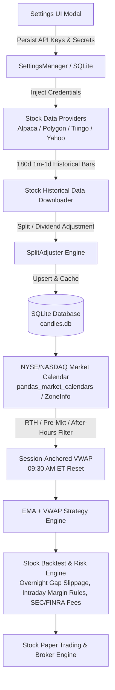

# Phase 7: US Stock Trading Integration Architecture Outline

## Overview
Phase 7 extends the multi-asset algorithmic trading engine to support US Equities (NYSE, NASDAQ, AMEX) alongside cryptocurrencies. It integrates multi-source stock market data providers (Alpaca, Polygon, Tiingo, Yahoo/Synthetic), handles corporate actions (split and dividend adjustments), enforces US/Eastern (ET) exchange trading session hours, anchors intraday VWAP calculations to 09:30 AM ET market open, models stock execution mechanics (fractional sizing, overnight gap slippage, SEC/FINRA regulatory fees), and manages API credentials securely in the UI Settings modal.

---

## Architecture Components & Beads Breakdown

### 1. `ema_vwap-k0w.4`: Stock Provider & Broker API Key Management in Settings UI
- **Backend Schema & Settings Store**:
  - Extend `SettingsManager` in `src/settings.py` to manage stock credentials:
    - Alpaca API Key ID & Secret Key (Paper vs Live endpoints)
    - Polygon.io API Key
    - Tiingo API Key
    - Stock default exchange/feed selection (`alpaca`, `polygon`, `tiingo`, `yahoo`)
  - Mask secrets in API responses (`••••••••abcd`) while preserving untouched values during updates.
- **Frontend Settings Modal UI**:
  - Add dedicated **"US Equities & Stock Data Providers"** tab or card in Settings modal.
  - Provide individual key input fields, endpoint toggles (Sandbox/Paper vs Live), and "Test Connection" buttons.

### 2. `ema_vwap-k0w.1`: Stock Historical Data Downloader & Split-Adjusted SQLite Caching
- **Stock Provider Adapters (`src/providers/`)**:
  - `AlpacaStockAdapter`: Connects to Alpaca Market Data API v2 (`/v2/stocks/bars`), with automatic 180-day pagination, chunking, and rate-limit backoff.
  - `PolygonStockAdapter`: Connects to Polygon Aggregates API v2 (`/v2/aggs/ticker/{ticker}/range/...`).
  - `TiingoStockAdapter` / `YahooStockAdapter`: Fallback historical EOD and intraday data feeds.
  - `SyntheticStockAdapter`: High-fidelity deterministic multi-day synthetic stock market generator for unit testing with gap opens and split events.
- **Corporate Action & Split Adjustment Engine**:
  - Dynamic split factor adjustment (`adj_close`, `adj_volume`) or on-the-fly OHLC normalization to prevent artificial chart spikes from stock splits.
- **SQLite Storage & Normalization**:
  - Cache candles under `exchange="alpaca"` / `exchange="polygon"` and uppercase ticker symbols (`AAPL`, `SPY`, `TSLA`, `NVDA`, `QQQ`).

### 3. `ema_vwap-k0w.2`: NYSE/NASDAQ Market Calendar & 9:30 AM ET Session-Anchored VWAP
- **Exchange Market Hours & Calendar**:
  - Support Regular Trading Hours (RTH: 09:30 - 16:00 ET).
  - Pre-Market (04:00 - 09:30 ET) and After-Hours (16:00 - 20:00 ET) toggle options.
  - Market holiday and early close detection (e.g. Thanksgiving, Christmas, July 4th).
- **Session-Anchored VWAP**:
  - Refactor `compute_vwap()` in `src/indicators.py` to accept timezone-aware session anchors (resetting at `09:30 AM US/Eastern` on trading days, rather than `00:00 UTC`).

### 4. `ema_vwap-k0w.3`: Stock Execution Engine with Overnight Gap Slippage & Intraday Margin Rules
- **Overnight Gap Slippage Simulation**:
  - Model gap openings between market close ($16:00$ ET) and next market open ($09:30$ ET).
- **Regulatory Rules & Fee Structures** (SEC-approved effective June 4, 2026):
  - **New Intraday Margin Framework**: Minimum $2,000 equity with unlimited day trades. Real-time position-level margin monitoring enforces 4:1 buying power for longs and 2:1 for shorts based on prior-day maintenance margin excess. Intraday margin calls trigger auto-liquidation rather than 90-day trading freeze.
  - SEC Section 31 transaction fees and FINRA Trading Activity Fees (TAF) on equity sell orders.
  - Fractional vs Whole share position sizing constraints.

---

## Quality & Validation Gates
1. Unit and integration tests covering:
   - Settings management and credential masking for stock providers.
   - Alpaca, Polygon, and Tiingo response parsing and rate limit handling.
   - Split adjustment calculations against known corporate action benchmarks.
   - Session-anchored VWAP 09:30 ET reset vs 24/7 crypto UTC reset.
   - Intraday margin monitoring (4:1 longs, 2:1 shorts) and overnight gap execution in the backtester.
2. Full test suite execution: `pytest` passing 100%.
3. Docker daemon rebuild and verification.
