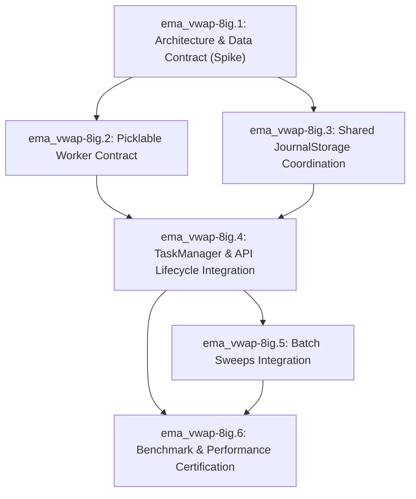

# Phase 8: Process-Based Optuna Optimization Architecture Outline

> **Status:** Specification & Architecture Decision Record (Bead `ema_vwap-8ig.1`)  
> **Target Epic:** `ema_vwap-8ig` (Process-based Optuna optimization architecture)  
> **Scope:** Single-host process-parallel Optuna execution for EMA/VWAP strategy optimization.

---

## 1. Executive Summary & Goals

The EMA/VWAP trading framework uses Optuna to optimize strategy hyperparameters (EMA lengths, VWAP bands, ATR stop multipliers, trailing stops, risk-reward ratios). Currently, `OptunaOptimizer.optimize()` runs a nested objective closure capturing local state, uses Optuna's default in-memory study storage (`InMemoryStorage`), and relies on `study.optimize(..., n_jobs=N)`. 

In Python, Optuna's `n_jobs` parameter executes within a multi-threaded `ThreadPoolExecutor`. Because backtests in Python are CPU-bound and subject to the CPython Global Interpreter Lock (GIL), multi-threading yields negligible speedup. Furthermore, attempting to use multiprocessing directly with `InMemoryStorage` fails because memory is not shared across processes.

This document defines the process-parallel Optuna architecture that:
1. Operates reliably on **Windows (`spawn`)** and Linux (`fork`/`spawn`).
2. Eliminates GIL bottlenecks via true multi-process execution.
3. Coordinated through **Optuna's `JournalStorage`** (`JournalFileBackend`), avoiding SQLite table locks.
4. Maintains **sequential execution as the safe default**, making process parallelism an explicit, opt-in feature validated by throughput thresholds.

---

## 2. Architecture Decisions & Scope

### 2.1 Single-Host vs. Multi-Node Scope
* **Decision: Single-host multi-processing only.**
* **Rationale:**
  * The application runs locally or within a dedicated container/workstation.
  * Single-host multi-processing provides full utilization of local CPU cores (e.g., 8–32 physical threads).
  * Multi-node distributed clusters require remote networking, RDBMS deployment (PostgreSQL/MySQL), shared NFS filesystems, and complex failure modes.
* **Status:** Multi-node and remote RDBStorage are explicitly **deferred** to future phases.

### 2.2 Shared Storage: JournalStorage vs. RDBStorage vs. SQLite
* **Decision: Use Optuna `JournalStorage` with `JournalFileBackend`.**
* **Rejected Alternative 1: SQLite (`RDBStorage(url="sqlite:///...")`)**
  * Official Optuna documentation explicitly cautions against SQLite for concurrent access due to frequent table lock errors (`sqlite3.OperationalError: database is locked`).
* **Rejected Alternative 2: PostgreSQL / MySQL (`RDBStorage`)**
  * Requires running external database daemons, schema migrations, and user credential management for what should be a self-contained local backtest run.
* **Selection: `JournalFileBackend`**
  * Designed specifically by the Optuna team for same-host multi-process optimization.
  * Uses append-only file operations with OS-level atomic file locks (`msvcrt` on Windows, `fcntl` on POSIX).
  * Eliminates database deadlocks while allowing concurrent trial evaluations and centralized Pareto frontier aggregation.

### 2.3 Storage Lifecycle & Cleanup Policy
1. **Creation:** A unique journal file is allocated per optimization run in a managed temporary directory:
   ```python
   journal_path = tempfile.mktemp(prefix="optuna_journal_", suffix=".log", dir=cache_dir)
   storage = optuna.storages.JournalStorage(
       optuna.storages.JournalFileBackend(journal_path)
   )
   ```
2. **Study Registration:** A named study (`study_name=f"study_{task_id}_{uuid}"`) is created in the journal.
3. **Worker Attach:** Worker processes open the existing study via:
   ```python
   study = optuna.load_study(study_name=study_name, storage=storage)
   ```
4. **Completion & Cleanup:**
   * After workers terminate, the master process extracts trial results and Pareto-optimal parameter sets.
   * The temporary journal file is automatically unlinked/deleted unless `persist_study=True` is requested for forensic audits.
5. **Stale/Failed Trial Policy:**
   * Trials that encounter exceptions or abrupt worker crashes are marked as `optuna.trial.TrialState.FAIL`.
   * Pruned trials are marked as `optuna.trial.TrialState.PRUNED`.
   * Only `TrialState.COMPLETE` trials contribute to Pareto frontier selection.

---

## 3. Worker Contract & Data Transport

### 3.1 Windows `spawn` Picklability
Windows does not support POSIX `fork()`; it initializes worker processes by launching a fresh Python interpreter and importing the entry-point module (`spawn`).

* **Constraint:** A nested closure cannot be pickled by `multiprocessing` or `concurrent.futures`.
* **Solution:** Extract the objective function into an importable, top-level class or standalone function:
  ```python
  # src/optimization/worker.py
  def run_optuna_worker(
      worker_id: int,
      study_name: str,
      journal_path: str,
      config: OptunaConfig,
      base_params: StrategyParams,
      candles_df: pd.DataFrame,
      n_trials: int,
      timeout_seconds: float | None,
      seed: int,
  ) -> int:
      ...
  ```

### 3.2 Data Transport & Memory Estimation
* **Problem:** Serializing the candle DataFrame across IPC queues on *every single trial* introduces prohibitive serialization overhead and memory churn.
* **Solution:** Pass the candle DataFrame **once per worker process** upon launch:
  * For $W$ workers, the DataFrame is serialized exactly $W$ times (at startup), rather than $T$ times (per trial).
  * Inside each worker process, shared indicators (`compute_shared_indicators`) are precomputed **once** across the candle DataFrame before beginning trial loops.
* **Memory Estimates:**
  * 1-year 5-minute crypto dataset ≈ 105,120 rows × 6 float64 columns ≈ 5 MB in RAM.
  * For 8 worker processes: $8 \times 5\text{ MB} = 40\text{ MB}$ total overhead.
  * IPC transfer time: $<50\text{ ms}$ per worker at startup.
  * Per-trial IPC overhead: **0 MB** (only trial parameters and scalar objective values traverse IPC).

---

## 4. Coordination, Budgets, and Seeds

### 4.1 Total Trial & Time Budget Allocation
* **Trial Budget:**
  * If total trials = $N$ and worker count = $W$:
  * Each worker $i$ is assigned $k_i = \lfloor N / W \rfloor + (1 \text{ if } i < (N \pmod W) \text{ else } 0)$ trials.
  * $\sum k_i = N$, guaranteeing exact total trial count.
* **Timeout Allocation:**
  * All workers receive an absolute deadline: $\text{deadline} = \text{start\_time} + \text{timeout\_seconds}$.
  * Each worker checks `time.time() >= deadline` before starting a trial.
* **Cancellation:**
  * Controlled via `multiprocessing.Event` or `multiprocessing.Manager().Event()`.
  * If set, workers exit after the current trial without starting new ones.
  * In task manager/API flows, thread pools or process pools can be cleanly terminated with `.terminate()`.

### 4.2 Deterministic Sampler Seeds
To prevent parallel workers from exploring identical parameter coordinates:
* The master process receives or generates a `master_seed`.
* Each worker $i$ initializes its own `TPESampler`:
  $$\text{worker\_seed}_i = (\text{master\_seed} + i \times 10007) \pmod{2^{31} - 1}$$
* This guarantees that workers explore distinct regions of the parameter space while preserving run-to-run reproducibility when the master seed is fixed.

---

## 5. Performance Baselines & Decision Thresholds

### 5.1 Sequential as Default
* Multi-processing is **opt-in**:
  * `execution_mode="sequential"` (Default)
  * `execution_mode="multiprocess"` (Opt-in)
* Preserves 100% backward compatibility for existing scripts, tests, and low-resource environments.

### 5.2 Activation Thresholds
Process parallelism incurs fixed overhead (Python interpreter spawn on Windows: ~0.8s–1.2s per worker). Multi-processing should only be recommended or activated when:
1. `n_trials >= 50`
2. `len(candles) >= 5,000`
3. Measured throughput demonstrates at least a **1.5x speedup** over sequential execution.

---

## 6. Implementation Subphases & Dependency Graph



1. **ema_vwap-8ig.1** (Current): Specify process topology, storage, pickling, seeds, and decision thresholds.
2. **ema_vwap-8ig.2**: Refactor `OptunaOptimizer` objective logic into top-level, picklable worker functions.
3. **ema_vwap-8ig.3**: Implement `JournalStorage` manager, worker pool executor, and seed allocation.
4. **ema_vwap-8ig.4**: Integrate with `TaskManager` background tasks, progress reporting, and cancellation.
5. **ema_vwap-8ig.5**: Update `BatchOptimizer` to allow process-based execution across batch combinations.
6. **ema_vwap-8ig.6**: Benchmark speedup across worker counts, certify correctness, and document metrics.
