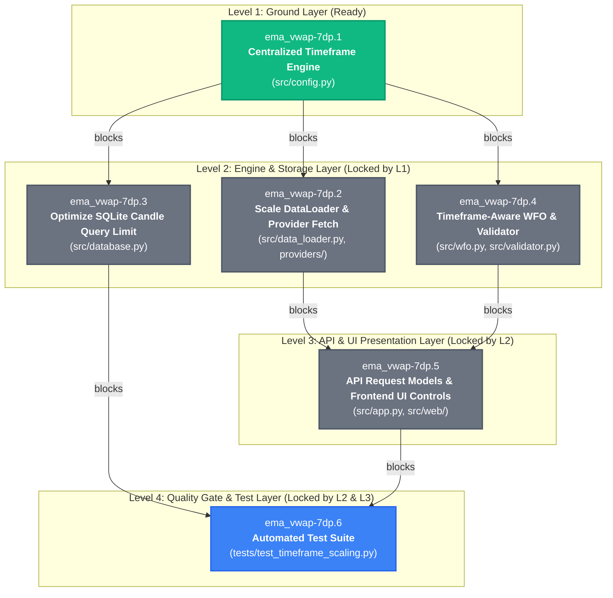

# Timeframe-Scaled Candle Architecture & Sub-Bead Prerequisite Graph

## Overview

To solve candle insufficiency for higher timeframes (15m, 30m, 1h, 4h, 1d) in Walk-Forward Optimization (WFO), backtesting, and validation, the work under parent bead **`ema_vwap-7dp`** has been decomposed into 6 atomic sub-beads. 

Development progresses strictly from the **ground up** (foundational domain logic & math $\rightarrow$ data access & storage $\rightarrow$ analytical engines $\rightarrow$ public API & UI $\rightarrow$ end-to-end integration tests).

---

## Prerequisite & Dependency Locking Graph

---

## Detailed Sub-Bead Lock & Prerequisite Analysis

| Level | Bead ID | Status | Prerequisites (Hard Blockers) | Why It Is Locked / Ground-Up Rationale |
| :--- | :--- | :--- | :--- | :--- |
| **Level 1** | **`ema_vwap-7dp.1`** Centralized Timeframe Engine | 🟢 **READY** (P1) | *None* (Root foundational bead) | **Ground Layer**: Implements `TimeframeSpec` dataclass, `get_timeframe_spec()`, `get_bars_per_day()`, and `get_optimal_lookback_days()` in `src/config.py`. All other modules depend on these calculations. |
| **Level 2** | **`ema_vwap-7dp.2`** Scale DataLoader & Providers | 🔴 **LOCKED** (P2) | `ema_vwap-7dp.1` | Cannot calculate dynamic `days_to_fetch` or eliminate hardcoded `// 288` until `TimeframeSpec` is available in `config.py`. |
| **Level 2** | **`ema_vwap-7dp.3`** Optimize SQLite Candle Query | 🔴 **LOCKED** (P2) | `ema_vwap-7dp.1` | SQL-level subquery windowing (`SELECT * FROM (SELECT ... ORDER BY timestamp DESC LIMIT ?) ORDER BY timestamp ASC`) depends on timeframe candle sizing and lookback specs. |
| **Level 2** | **`ema_vwap-7dp.4`** Timeframe-Aware WFO & Validator | 🔴 **LOCKED** (P2) | `ema_vwap-7dp.1` | `WalkForwardEngine` and `StrategyValidator` require asset-class aware `bars_per_day` (crypto 24/7 vs stock RTH) and warm-up buffer math to compute valid train/test splits. |
| **Level 3** | **`ema_vwap-7dp.5`** API Models & Frontend UI Controls | 🔴 **LOCKED** (P2) | `ema_vwap-7dp.2` `ema_vwap-7dp.4` | The REST API (`src/app.py`) and UI dropdowns (`src/web/index.html`, `app.js`) cannot expose multi-year range presets ("1Y", "2Y", "5Y", "Auto") until DataLoader can fetch those periods without timing out and the Validator can slice them without crashing. |
| **Level 4** | **`ema_vwap-7dp.6`** Automated Test Suite | 🔴 **LOCKED** (P2) | `ema_vwap-7dp.3` `ema_vwap-7dp.5` | End-to-end integration and regression tests validate the entire pipeline from query optimization up through API response schemas. |

---

## Execution Sequence

1. **Step 1**: Claim and execute **`ema_vwap-7dp.1`** in `src/config.py`.
   - Run unit tests to verify timeframe specifications and math.
   - Run `bd close ema_vwap-7dp.1`.
   - *Result*: Automatically unlocks `ema_vwap-7dp.2`, `ema_vwap-7dp.3`, and `ema_vwap-7dp.4`.
2. **Step 2**: Implement **`ema_vwap-7dp.3`** (SQLite query optimization in `src/database.py`).
   - Run database tests.
   - Run `bd close ema_vwap-7dp.3`.
3. **Step 3**: Implement **`ema_vwap-7dp.2`** (DataLoader & Provider scaling in `src/data_loader.py` and `src/providers/`).
   - Run loader tests.
   - Run `bd close ema_vwap-7dp.2`.
4. **Step 4**: Implement **`ema_vwap-7dp.4`** (WFO & Validator auto-slicing in `src/wfo.py` and `src/validator.py`).
   - Run validator and WFO tests.
   - Run `bd close ema_vwap-7dp.4`.
   - *Result*: Automatically unlocks `ema_vwap-7dp.5`.
5. **Step 5**: Implement **`ema_vwap-7dp.5`** (API request models and UI range controls in `src/app.py` and `src/web/`).
   - Run web UI tests.
   - Run `bd close ema_vwap-7dp.5`.
   - *Result*: Automatically unlocks `ema_vwap-7dp.6`.
6. **Step 6**: Implement **`ema_vwap-7dp.6`** (Automated test suite in `tests/test_timeframe_scaling.py`).
   - Run full quality gates: `pytest` and `ruff check`.
   - Close `ema_vwap-7dp.6` and finalize parent `ema_vwap-7dp`.
