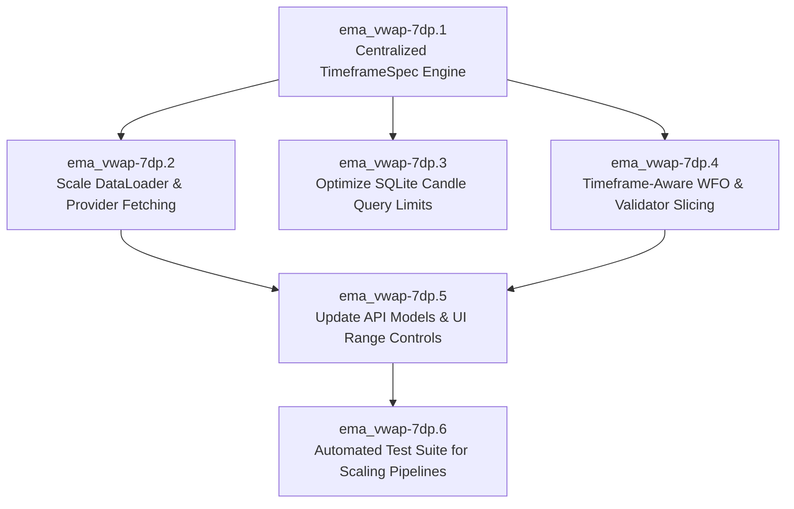

# Deep Research & Architectural Analysis: Scaling Candle Fetches, WFO & Backtesting for Higher Timeframes (15m+)

**Epic Reference**: `ema_vwap-7dp` (*Scale validation lookback and bars_per_day per timeframe*)

---

## 1. Executive Summary & Problem Formulation

In quantitative trading strategies relying on technical indicators—such as the Triple EMA (fast, slow, trend up to 250 bars), Volume Multiplier, ATR, and Session VWAP—a fixed historical lookback of **180 days** introduces severe statistical distortion when transitioning across timeframes and asset classes:

1. **Higher Timeframe Starvation (15m, 30m, 1h, 4h, 1d)**:
   - On **1d candles**, 180 days provides only **180 bars**. A trend EMA with length 200–250 **cannot even warm up**, producing zero valid signals and failing all validation gates.
   - On **4h candles**, 180 days yields only **1,080 bars**. In a 5-window Walk-Forward Optimization (WFO) with a 70% In-Sample (IS) split, each IS training window contains only ~360 bars—barely 110 bars after EMA warm-up—yielding virtually zero trades and breaking Out-of-Sample (OOS) statistical power.
   - On **1h candles**, 180 days is **4,320 bars** (~12 bars/day effective in some markets, 24 in crypto), severely limiting market regime diversity (bull, bear, consolidation).
2. **Lower Timeframe Bloat (1m, 3m)**:
   - On **1m candles**, 180 days requires fetching and storing **259,200 bars**. Over REST APIs, this requires 170+ paginated HTTP requests, risking rate limits, query timeouts, and multi-megabyte RAM overhead.
3. **Hardcoded Crypto Bias (288 bars/day)**:
   - The codebase frequently hardcodes `288` bars/day (e.g. in `data_loader.py` lines 370/375 `target_limit // 288`, `config.py` `bars_per_day = 288.0`, `app.py`).
   - In **US Equities (NYSE / NASDAQ)**, Regular Trading Hours (RTH) span 6.5 hours (390 minutes). 5m bars = 78 bars/day, 15m = 26 bars/day, 1h = 6.5 bars/day. Using 288 bars/day for stocks distorts OOS window slicing by a factor of 3.7x to 11x!
4. **Database Full-Scan Inefficiency (`src/database.py`)**:
   - `CandleDatabase.load_candles` loads the *entire* historical table for that symbol/timeframe into a pandas DataFrame before calling `df.tail(limit)`. As historical datasets grow from 180 days to 2–5 years, every backtest and live step incurs high latency and memory thrashing.

---

## 2. Quantitative Timeframe & Lookback Mathematical Model

To guarantee statistical validity, any historical dataset must satisfy three mathematical constraints:

$$\text{Total Bars} \ge \text{Warmup Bars} + \text{Trade Generation Window}$$

Where:
* **$\text{Warmup Bars} \ge 250$** (required for EMA 200/250 and VWAP stabilization).
* **$\text{Minimum Trade Count} \ge 30\text{ to }100$ trades** across the full backtest.
* **For WFO ($K$ windows, in-sample ratio $R_{\text{IS}} = 0.70$)**:
  $$\text{IS Bars per Window} = \frac{\text{Total Bars}}{K \cdot (1 - R_{\text{IS}}) + R_{\text{IS}}} \cdot R_{\text{IS}} \ge 300\text{ bars}$$
  $$\text{OOS Bars per Window} = \text{Target OOS Days} \times \text{Bars Per Day} \ge 100\text{ bars}$$

### Optimal Lookback Schedule

| Timeframe | Crypto Bars/Day (24/7) | Equity Bars/Day (RTH 6.5h) | Minimum Calendar Days | Recommended Default Days | Expected Total Bars (Crypto) | Expected Total Bars (Equities) | Primary Use Case |
|---|---|---|---|---|---|---|---|
| **1m** | 1,440 | 390 | 14 | **30 – 60** | 43,200 – 86,400 | 11,700 – 23,400 | Intraday scalping & microstructure |
| **3m** | 480 | 130 | 30 | **60 – 90** | 28,800 – 43,200 | 7,800 – 11,700 | Momentum timing & donor resampling |
| **5m** | 288 | 78 | 60 | **180** | 51,840 | 14,040 | Core baseline day trading |
| **15m** | 96 | 26 | 180 | **365 (1 Year)** | 35,040 | 9,490 | Institutional trend & swing timing |
| **30m** | 48 | 13 | 365 | **730 (2 Years)** | 35,040 | 9,490 | Multi-day swing trading |
| **1h** | 24 | 6.5 | 730 | **1,095 (3 Years)** | 26,280 | 7,117 | Macro regime & institutional bias |
| **2h** | 12 | 3.25 | 1,095 | **1,460 (4 Years)** | 17,520 | 4,745 | Extended swing positioning |
| **4h** | 6 | ~1.6 | 1,460 | **1,825 (5 Years)** | 10,950 | ~2,920 | Core structural trend validation |
| **1d** | 1 | 1 | 1,825 | **3,650 (10 Years)** | 3,650 | 2,520 | Multi-cycle secular macro backtesting |

---

## 3. Provider Pagination & Exchange API Feasibility

| Provider | Max Bars Per Request | Time Required for 1 Year of 15m (35k bars) | Time Required for 3 Years of 1h (26k bars) | Time Required for 5 Years of 4h (11k bars) | Rate Limit / Notes |
|---|---|---|---|---|---|
| **KuCoin** | 1,500 | ~24 HTTP calls (< 3 sec) | ~18 HTTP calls (< 2 sec) | ~8 HTTP calls (< 1 sec) | Paginated by `startAt`/`endAt` unix timestamps. Highly efficient for higher timeframes. |
| **Gemini** | ~500 | N/A (Limited depth on REST) | N/A | N/A | Gemini REST v2 returns max ~500 bars per call; donor resampling from 1h/1d or local cache recommended. |
| **Alpaca** | 10,000 (IEX/SIP) | ~1-2 calls (< 1 sec) | ~1 call (< 1 sec) | ~1 call (< 1 sec) | Multi-page token pagination; fast and scalable. |
| **Polygon** | 50,000 | 1 call (< 1 sec) | 1 call (< 1 sec) | 1 call (< 1 sec) | Single call can retrieve up to 50,000 bars per query. |
| **Synthetic** | Instant | Instant (< 50 ms) | Instant (< 50 ms) | Instant (< 50 ms) | Configurable `num_bars` parameter directly. |

> [!TIP]
> Higher timeframes actually require **significantly fewer HTTP requests** to cover years of data than 1m or 5m require for a few months! For example, 3 years of 1h candles is only 26,280 bars (~18 KuCoin requests), whereas 180 days of 1m was 259,200 bars (173 requests).

---

## 4. Sub-Bead Decomposition for `ema_vwap-7dp`

The work is organized into 6 atomic, dependency-linked sub-beads under `ema_vwap-7dp`:



### Detailed Sub-Bead Specifications

#### 1. `ema_vwap-7dp.1`: Centralized Timeframe & Lookback Specification Engine (P1 · Ready)
- **Goal**: Create a single authoritative source of truth in `src/config.py` for timeframe metadata.
- **Components**:
  - `TimeframeSpec` dataclass: `timeframe: str`, `bars_per_day_crypto: float`, `bars_per_day_stock: float`, `default_lookback_days: int`, `min_lookback_days: int`, `max_lookback_days: int`, `seconds: int`, `min_warmup_bars: int`.
  - Helper `get_timeframe_spec(timeframe: str, asset_type: str = "crypto") -> TimeframeSpec`.
  - Helper `get_optimal_lookback_days(timeframe: str, asset_type: str = "crypto") -> int`.
  - Helper `get_bars_per_day(timeframe: str, asset_type: str = "crypto") -> float`.

#### 2. `ema_vwap-7dp.2`: Scale DataLoader and Provider Fetch Architecture for 15m+ Lookbacks (P2)
- **Goal**: Eliminate hardcoded `// 288` and default 180-day limits across data loaders and providers.
- **Components**:
  - In `src/data_loader.py`:
    - In `load_candles()`: Calculate `days_to_fetch = days if days is not None else get_optimal_lookback_days(timeframe, asset_type)`.
    - Replace `target_limit // 288` with `target_limit // int(get_bars_per_day(timeframe, asset_type))`.
    - In `fetch_and_update_candles()`: Align lookback logic with `TimeframeSpec`.
  - In `src/providers/crypto.py`, `alpaca.py`, `polygon.py`, `synthetic.py`:
    - Update provider defaults to query `get_optimal_lookback_days(timeframe)` if `days` is None.

#### 3. `ema_vwap-7dp.3`: Optimize SQLite Candle Query Execution with Direct Window Limit (P2)
- **Goal**: Eliminate memory overhead and delay when querying cached candle data.
- **Components**:
  - In `src/database.py` `CandleDatabase.load_candles()`:
    - Instead of loading all rows and calling `df.tail(limit)` in Python, query the most recent `limit` rows directly:
      ```sql
      SELECT timestamp, open, high, low, close, volume FROM (
          SELECT timestamp, open, high, low, close, volume 
          FROM candles 
          WHERE exchange = ? AND symbol = ? AND timeframe = ?
          ORDER BY timestamp DESC
          LIMIT ?
      ) ORDER BY timestamp ASC
      ```
    - Drastically accelerates backtesting, Optuna sweeps, and WFO iterations.

#### 4. `ema_vwap-7dp.4`: Timeframe-Aware WFO and StrategyValidator Auto-Slicing (P2)
- **Goal**: Ensure Walk-Forward Optimization and StrategyValidator Gates 1, 2, and 3 accurately scale across 15m, 30m, 1h, 4h, 1d.
- **Components**:
  - In `src/wfo.py`:
    - Pass dynamic `bars_per_day` resolved from `TimeframeSpec`.
    - Enforce warm-up constraint: `is_bars >= trend_ema_max + 50`.
  - In `src/validator.py`:
    - In `validate()`: Infer timeframe and `bars_per_day` from candle index or parameter; pass down to `WalkForwardEngine`.
    - Adjust trade count and Sharpe expectations based on trading frequency.

#### 5. `ema_vwap-7dp.5`: Update API Request Models and Frontend UI Range Controls (P2)
- **Goal**: Expose timeframe-scaled lookback options in the API and Web UI.
- **Components**:
  - In `src/app.py`:
    - Tear-sheet endpoints (`/api/tear-sheet/*`): Replace hardcoded `limit=1000` with optimal timeframe lookback.
    - `/api/backtest`, `/api/optimize`, `/api/batch_optimize`: Use `days: int | None = None`, defaulting to `get_optimal_lookback_days(timeframe)`.
  - In `src/web/index.html` & `src/web/app.js`:
    - Add adaptive options to `data-range-select`:
      - `optimal` ("Auto: Optimal for Selected Timeframe")
      - `1_year` ("1 Year (365 Days)")
      - `2_years` ("2 Years (730 Days)")
      - `5_years` ("5 Years (1,825 Days)")
    - In `getDataRangeParams()`: Calculate `limit` dynamically based on selected timeframe instead of assuming 5m / 288 bars/day.

#### 6. `ema_vwap-7dp.6`: Automated Test Suite for Timeframe-Scaled Candle Pipelines (P2)
- **Goal**: Comprehensive regression tests protecting timeframe scaling across the entire pipeline.
- **Components**:
  - `tests/test_timeframe_scaling.py`:
    - Test `TimeframeSpec` for all crypto and equity timeframes (1m to 1d).
    - Test `DataLoader.load_candles` produces sufficient candles for 15m (365d), 1h (730d), and 4h (1825d).
    - Test WFO window generation on 15m, 1h, and 1d datasets with correct OOS target sizes.
    - Test SQLite query optimization matches expected candle order and row limit without memory leakage.
